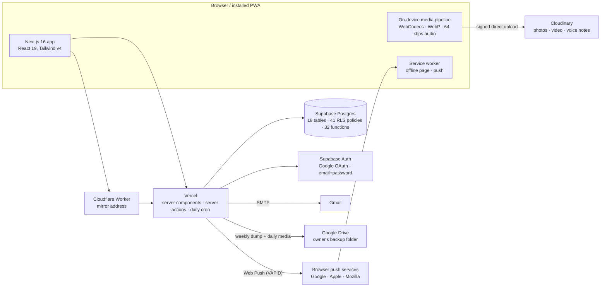
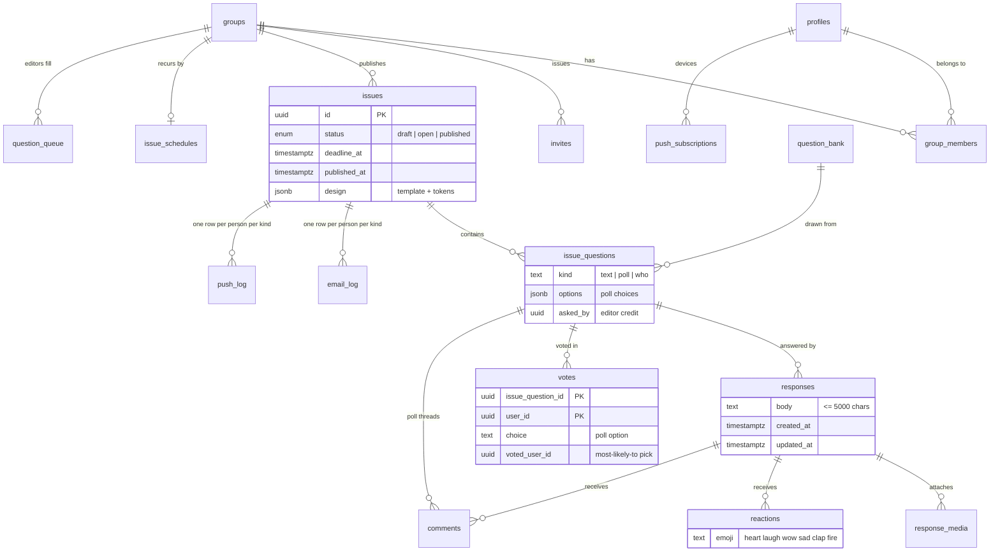
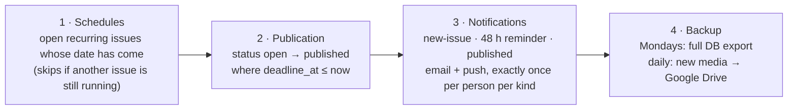

# Haber Var

**A collaborative newspaper for groups of friends who live far apart, built as a complete, privacy-first data product on free infrastructure.**

[](https://github.com/kutay-atak/haber-var/actions/workflows/ci.yml)     

Every few weeks a group answers the same handful of questions: text, photos, a short video, a voice note, a poll, a "most likely to…" vote. Answers stay sealed until a deadline, then everything is typeset into a newspaper the whole group reads at once. *Haber Var* is Turkish for "there's news".

It has run a real newspaper for one group since October 2026, in Turkish and English, on the free tiers of Vercel, Supabase, Cloudinary and Cloudflare.

- **Feature tour (what members see):** [docs/features.md](docs/features.md)
- **Setup guide (Turkish, 30–45 min, no cost):** [Instructions.md](Instructions.md)

---

## Contents

1. [Why it is interesting](#why-it-is-interesting)
2. [System architecture](#system-architecture)
3. [Data model](#data-model)
4. [Access control as data governance](#access-control-as-data-governance)
5. [The daily pipeline](#the-daily-pipeline)
6. [Data produced, and what could be done with it](#data-produced-and-what-could-be-done-with-it)
7. [Engineering practices](#engineering-practices)
8. [Repository map](#repository-map)
9. [Running your own copy](#running-your-own-copy)
10. [Roadmap](#roadmap)
11. [Contributing, security, licence](#contributing-security-licence)

---

## Why it is interesting

Group chats answer "where are you?" and bury "how are you, really?". Haber Var replaces a stream of messages with a **periodic, synchronous release**: a fixed questionnaire, a deadline, a sealed collection period and a single publication moment. That is a survey design as much as a product design, and it shapes the whole system:

- **Sealed responses.** Nobody, including the admin, can read another member's answer or vote before publication. This is enforced in the database, not in the interface (see [access control](#access-control-as-data-governance)).
- **Secret ballots with public tallies.** "Most likely to…" votes are released only as aggregates; the raw voter → candidate rows are never readable by any client.
- **Repeated measures.** Issues recur on a schedule, so the same people answer comparable questions over time. Participation, response latency and reaction patterns accumulate as longitudinal data (see [data produced](#data-produced-and-what-could-be-done-with-it)).
- **Zero marginal cost.** Media is compressed on the member's device before upload, the newspaper is rendered server-side on demand, and every service runs on a free plan. The constraint forced careful measurement of storage and bandwidth per member per issue.

The project is small (about 14,600 lines of TypeScript and 1,500 lines of SQL) but complete: authentication, roles, scheduling, media processing, nine typeset templates with a live design studio, print/PDF output, email and Web Push notifications, a Turkey-reachable mirror address and automated backups.

---

## System architecture



| Concern | Choice | Why |
|---|---|---|
| Rendering | Server components; pages rendered per request, no client-side data fetching | Almost every page is private and personalised; simplest correct model |
| Mutations | Next.js server actions validated with Zod | One code path from form to database; CSRF protection built in |
| Authorisation | Postgres row-level security and `security definer` functions | The database is the single source of truth for who may read what, and when |
| Media | Browser-side transcoding (720p H.264, WebP, 64 kbps audio), signed direct-to-Cloudinary uploads | Keeps a group of ten inside a 25 GB/month free quota; server never touches media bytes |
| Scheduling | One Vercel cron call per day | Free tier allows one daily job; all time-based behaviour is idempotent and catch-up safe |
| Reachability | Cloudflare Worker reverse proxy | `*.vercel.app` is unreachable from some networks in Türkiye; the mirror costs nothing |
| Durability | Weekly full database export and daily incremental media copy to the owner's Google Drive | Supabase's free plan has no backups; restoring from a vendor outage must be possible |

---

## Data model

Eighteen tables, all with row-level security. The core of the schema:



Design notes:

- **Natural keys where they encode a rule.** `votes` is keyed by `(issue_question_id, user_id)`: one vote per person per question, enforced by the table itself. `email_log` and `push_log` are keyed by `(issue_id, user_id, kind)`, which is what makes notifications exactly-once.
- **Closed vocabularies are enforced** by Postgres enums (`issue_status`, `media_kind`, `member_role`) or check constraints (question kind, reaction emoji), so analysis never has to guess at free-text categories.
- **Timestamps everywhere.** `created_at` and `updated_at` on answers, `deadline_at` and `published_at` on issues, `created_at` on votes, reactions and comments: every behavioural event is datable relative to its issue.
- **Migrations are idempotent and additive.** Seven SQL files in `supabase/migrations/` build the schema; each can be re-run safely and none rewrites user data.

---

## Access control as data governance

The question "who may see this row, and when?" is answered once, in Postgres:

| Rule | Mechanism |
|---|---|
| Members see only their own groups | `is_member(group_id)` in every policy |
| Drafts are visible to admins and editors, invisible to members | `can_view_issue()` checks status and role |
| Answers and votes are invisible to everyone else until `published_at` | Policies call `issue_is_published()`; the application cannot override it |
| Answers are editable only while the issue is open | `issue_is_open()` in the `update` policies |
| "Most likely to…" votes are never readable row by row | No `select` policy for other members' rows; a `security definer` function `who_vote_counts()` returns only aggregates, after publication |
| Poll choices are public after publication | Separate policy; the voting screen says so |
| Media cannot be attached to someone else's answer | Trigger checks ownership and per-answer limits (4 photos, 1 video, 1 voice note) |
| Comments inherit their issue's visibility | Trigger copies `issue_id` from the answer or poll |

Two consequences matter for anyone working with the data:

1. **Pre-publication leakage is a database bug, not an application bug.** Reviewing the 41 policies and 8 triggers is sufficient to audit confidentiality.
2. **Aggregation boundaries are explicit.** The one place where individual-level data is deliberately reduced to counts (`who_vote_counts`) is a named function with its own grants, which is the right shape for any future privacy-preserving statistic.

Secrets (service-role key, Cloudinary secret, SMTP password, Drive refresh token) are read only in `server-only` modules. Inputs are validated twice: Zod in the server action, constraints and triggers in the database.

---

## The daily pipeline

One scheduled request per day (`/api/cron`, 07:00 UTC) runs four idempotent stages in order:



- Stages 1–3 also run immediately when an admin starts or publishes an issue, so members are not kept waiting for the next morning.
- Exactly-once delivery comes from the `email_log` / `push_log` primary keys, not from in-memory state, so a failed or repeated run is safe.
- Comment and reaction notifications are event-driven (sent after the write, outside the request path) and grouped per thread so a phone shows one notification per conversation.
- The backup stage is time-boxed; media that does not fit in the window continues the next day. A table that fails to export is recorded in the dump's `_errors` without blocking the rest.

---

## Data produced, and what could be done with it

Running the newspaper produces a tidy, timestamped, relational record of group behaviour. None of the analyses below are implemented yet; this section describes what the schema already supports and is the direction I intend to take the project.

| Question | Data already captured | Method |
|---|---|---|
| Who takes part, and how consistently? | `responses` × `issues` × `group_members` | Participation rates per member and per issue; panel view across issues |
| How long after an issue opens do people answer? | `responses.created_at` − `issues.created_at`, `deadline_at` | Response-latency distributions; survival curves of "time to first answer"; effect of the 48 h reminder as a before/after comparison using `email_log`/`push_log` timestamps |
| Which questions draw the richest answers? | `issue_questions` × `responses.body`, `response_media` | Answer length, media attachment rate and comment count per question; ranking of the 142 prompts in the pool |
| Does the group's engagement decay? | Issue number vs participation, reactions, comments | Trend models with group and member effects; early-warning signal for recurring issues |
| Do polls and "most likely to…" votes agree with self-report? | `votes` vs text answers | Exploratory, within the privacy constraint that secret ballots stay aggregated |
| What does the media footprint cost per member per issue? | `response_media.bytes`, `kind`, `duration_s` | Already used informally to size the free tier; a proper model would predict quota exhaustion |

Design decisions that make this feasible later rather than painful:

- Every event has an actor, a target and a timestamp; nothing is overwritten except an answer's own body before the deadline (`updated_at` keeps the last edit time).
- Categorical fields are enums, membership and roles are rows, and question text is linked to a stable pool entry so the same prompt can be compared across groups.
- The weekly backup is a single JSON document with one array per table, which is a convenient analysis export in its own right.
- Any analysis that leaves the owner's machine must respect the same visibility rules as the app; the `who_vote_counts` function is the pattern to follow for releasing aggregates only.

---

## Engineering practices

- **TypeScript in strict mode** end to end; database row types mirrored in `src/lib/types.ts`.
- **Two-layer validation:** Zod schemas in server actions, `check` constraints, triggers and security-definer functions in Postgres.
- **Idempotent, additive migrations** that never delete or rewrite user data; a running issue's answers survive every deployment.
- **Internationalisation at the string level:** every user-facing string is written in Turkish and English at the call site, including 142 question prompts and all email templates; each member's emails arrive in their own language.
- **Typesetting as code:** nine newspaper templates driven by design tokens (CSS custom properties), container queries so a template responds to the newspaper's width rather than the viewport, and print CSS that keeps each question on one page and hyphenates justified columns.
- **Three layers of automated tests, run on every push by GitHub Actions** (`.github/workflows/ci.yml`):
  - `tests/sql/`: the migrations are applied to a fresh Postgres 16 on top of a small Supabase stand-in, three of them a second time to prove idempotency, and 170+ assertions exercise the policies and functions as different users (outsider, member, editor, admin; before and after publication; secret ballots).
  - `tests/unit/`: the notification and backup pipelines and the Cloudflare mirror run against in-memory fakes of Supabase, Web Push, Google Drive and Cloudinary (`node --test`, no extra framework).
  - `tests/e2e/`: Playwright drives a production build at phone and desktop widths through the pages that need no account: landing, privacy, the nine templates in the design-studio demo, print view, offline page and manifest.
  - Plus `eslint`, `tsc --noEmit` and a full `next build`.
- **Operational honesty:** every background failure is logged with a stable prefix (`[bildirim]`, `[yedek]`, `[giriş]`) and surfaced to the owner where possible, rather than swallowed.

---

## Repository map

```
src/
├── app/                      Routes (App Router)
│   ├── (auth)/               Sign-in, sign-up, password reset
│   ├── (app)/gruplar/        Groups, settings, new issue, default design
│   ├── (app)/sayi/[id]/      Answering · newspaper · draft editing · design studio
│   ├── (app)/profil/         Profile and notification settings
│   ├── api/cron/             The daily pipeline
│   ├── api/yedek/            One-time Google Drive connection for backups
│   ├── gizlilik/             Privacy page
│   └── sablonlar/            Public design-studio demo (no account needed)
├── actions/                  Server actions (all mutations)
├── components/
│   ├── newspaper/templates/  The nine templates
│   ├── design/               Design studio with live preview
│   └── pwa/                  Install prompts, push settings
└── lib/
    ├── data/                 Read models for pages
    ├── media/                On-device image, video and audio compression
    ├── notifications.ts      Who gets which email/push, when
    ├── schedule-runner.ts    Recurring issues
    ├── backup.ts             Google Drive backup
    └── supabase/             Clients and session middleware
supabase/migrations/          Schema, policies, functions, question pool (7 files)
cloudflare-worker.js          Mirror address for networks that block vercel.app
tests/                        SQL policy tests · unit tests with fakes · Playwright browser tests
docs/features.md              Feature tour
Instructions.md               Setup and operations guide (Turkish)
```

---

## Running your own copy

Everything runs on free plans; setup takes 30–45 minutes and is documented step by step in [Instructions.md](Instructions.md) (Turkish). In short:

1. Create a Supabase project and run the SQL files in `supabase/migrations/` in order.
2. Create a Google OAuth client (for sign-in) and a Cloudinary account (for media).
3. Copy `.env.example` to `.env.local`, fill in the keys, `npm install && npm run dev`.
4. Deploy to Vercel; the cron job in `vercel.json` handles scheduling, publication, notifications and backups.
5. Optionally add the Cloudflare mirror and connect Google Drive for backups.

A public demo of the design studio runs at `/sablonlar` on any deployment, using a sample issue.

Tests: `npm run test:unit` (no setup), `npm run test:sql` (needs a Postgres reachable through the usual `PG*` variables, or `bash tests/sql/run.sh --local` with Postgres 16 installed), `npm run test:e2e` (builds the app and runs Playwright; `npx playwright install chromium` once).

---

## Roadmap

- Browser tests for signed-in flows (answering, voting, publishing) against a disposable Supabase project.
- An analytics notebook over the weekly export: participation, response latency and prompt quality (see [above](#data-produced-and-what-could-be-done-with-it)).
- An opt-in "year in review" issue generated from a group's own statistics.
- PDF archive of every published issue in the backup folder.
- Screen-reader audit of the newspaper templates (see [ACCESSIBILITY.md](ACCESSIBILITY.md)).

---

## Contributing, security, licence

- Contributions are welcome; please read [CONTRIBUTING.md](CONTRIBUTING.md) and the [Code of Conduct](CODE_OF_CONDUCT.md).
- Security and privacy issues: [SECURITY.md](SECURITY.md). Please do not open public issues for them.
- Accessibility status and how to report barriers: [ACCESSIBILITY.md](ACCESSIBILITY.md).
- Licence: [MIT](LICENSE).

Built by **Kutay Atak** for one group of friends spread across several countries, and shared in case it is useful to others.
